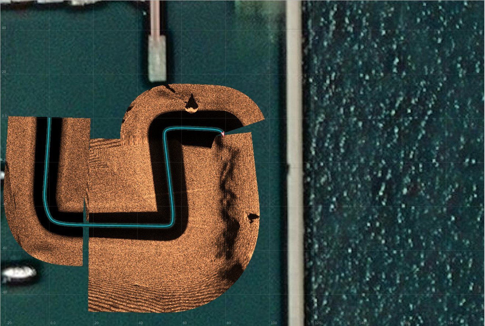
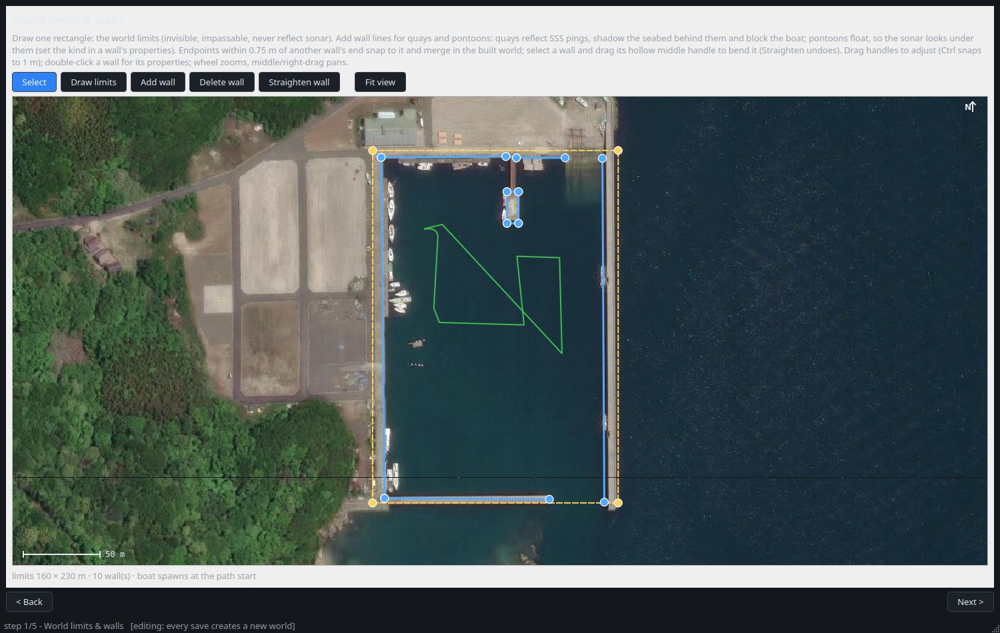
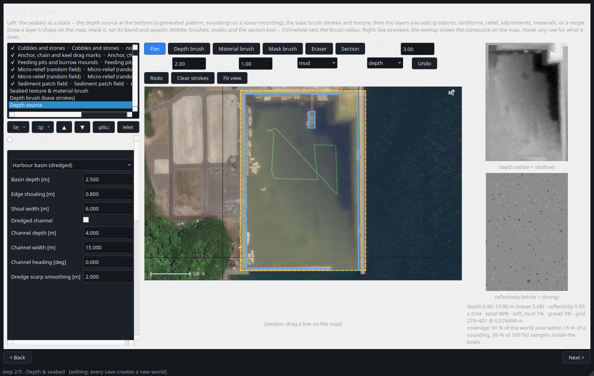

# BlueBoat-SSS-Sim — simulated harbours and a simulated side-scan sonar

The simulator of the BlueBoat project. It builds **Gazebo worlds anchored to real GPS positions**
(harbour walls, seabed depth, litter objects) and runs a **simulated side-scan sonar (SSS)** that
publishes exactly what the real sonar driver publishes. The rest of the project (sonar processing,
Ground Control Station, detector, belief map, replanner, controllers) runs unchanged on top of it.



*A simulated survey in a harbour world, drawn by the Ground Control Station exactly as it draws a
real one. The copper area is the simulated sonar mosaic, the blue line the boat's track. The dark
shapes with a shadow are objects placed in the world.*

> **Status: frozen on 18 November 2026, as a model-conditional tool.** The literal verdict of the
> acceptance protocol is **NOT READY**; the owner froze the simulator anyway, so that its results
> are used as comparisons under stated conditions. A simulated result is valid only inside the
> conditions of the superproject's [`SIM_VALIDITY_CONDITIONS.md`](../SIM_VALIDITY_CONDITIONS.md), and
> every result sentence starts with *"In a calibrated simulation environment, ..."*. Version 1.1
> (21 November 2026) changed **world generation only**: a "Mission-like" object placement based on
> documented harbour statistics. The sonar, sea and boat models are unchanged.

## What you can do with it

- **Build a world around a survey path** with the **World Builder** wizard: draw the world limits
  and the quays on a satellite map, author the depth (harbour, river, beach, canal, or real
  soundings), place objects by hand or from harbour statistics, preview and save.
- **Generate many harbour worlds without a screen**, from a specification file and a list of seeds
  (for datasets and experiment campaigns).
- **Run the simulated sonar** in Gazebo: the GPU ray-cast sensor is the production sensor; an older
  geometric renderer remains for quick tests.
- **Add a sea state**: current, waves and wind acting on the boat in Gazebo, from presets or timed
  plans.
- **Get ground truth**: every world lists each object with its GPS position, and the sonar
  publishes which objects each ping saw.
- **Calibrate and compare** with the field recordings (`.svlog`) using the offline tools.



*World Builder, screen "World limits & walls", on a real harbour. Yellow dashed rectangle: the world
limits (invisible, never reflect sound). Blue lines: quays and a pontoon that reflect the sonar.
Green line: the survey path the world is built around.*



*Screen "Depth & seabed": the seabed is a stack of layers (basin shape, sediment patches, relief,
drag marks...). On the right, the depth preview (white = shallow) and the reflectivity preview.*

## How it connects to the other modules

```
[ simulated sonar: BlueBoat-SSS-Sim ] → Perception → Belief → Replanner → Control
           (replaces the real sonar driver of BlueBoat-SSS)
```

| Module | Link | Relation to the simulator |
|---|---|---|
| BlueBoat-Control | [github.com/Kyyrron/BlueBoat-Control](https://github.com/Kyyrron/BlueBoat-Control) | Its boat model and controllers drive the simulated boat; provides the message types |
| BlueBoat-MCS | [github.com/Kyyrron/BlueBoat-MCS](https://github.com/Kyyrron/BlueBoat-MCS) | Draws the survey paths worlds are built around, and launches simulations in them |
| BlueBoat-SSS | [github.com/Kyyrron/BlueBoat-SSS](https://github.com/Kyyrron/BlueBoat-SSS) | Its processor and Ground Control Station read the simulated sonar as if it were real |
| BlueBoat-Perception | [github.com/Kyyrron/BlueBoat-Perception](https://github.com/Kyyrron/BlueBoat-Perception) | Its dataset mode turns simulated runs into labelled training images |
| BlueBoat-Belief, BlueBoat-Replanner | [Belief](https://github.com/Kyyrron/BlueBoat-Belief), [Replanner](https://github.com/Kyyrron/BlueBoat-Replanner) | Read a world's survey area; the replanner flies runs in simulated worlds |
| Whole project | [github.com/Kyyrron/BlueBoat-SideScanSonar](https://github.com/Kyyrron/BlueBoat-SideScanSonar) | The superproject, with the conditions file and a command-line run recorder |

The repository holds two ROS 2 packages: `blueboat_sss_sim` (the simulator) and
`blueboat_harbour_population` (the statistical model that places objects "mission-like").

## Dependencies

| Dependency | Link | Quick install |
|---|---|---|
| Ubuntu 24.04, ROS 2 Jazzy | [docs.ros.org](https://docs.ros.org/en/jazzy/Installation/Ubuntu-Install-Debs.html) | `sudo apt install ros-jazzy-desktop` |
| Gazebo Harmonic and its ROS bridge | [gazebosim.org](https://gazebosim.org/docs/harmonic/ros_installation/) | `sudo apt install ros-jazzy-ros-gz` |
| BlueBoat-Control (boat model, controllers, message types) | [README](https://github.com/Kyyrron/BlueBoat-Control) | see its installation |
| Python packages (numpy, scipy, PyYAML, PySide6, ...) | superproject `requirements.txt` | `pip install -r requirements.txt` in the workspace venv |
| NVIDIA Warp, for the GPU ray-cast sonar | [nvidia.github.io/warp](https://nvidia.github.io/warp/) | `/usr/bin/python3 -m pip install --user --break-system-packages warp-lang==1.19.0` |
| An NVIDIA graphics card with CUDA | | needed for the ray-cast sensor (tested on an 8 GB card) |

**Warp must be installed for the system Python** (`/usr/bin/python3`), because the sonar node runs
on it, and in the workspace venv too (the superproject's `requirements.txt` has it).

## Installation, step by step

```bash
# 1. Get the project with its submodules
mkdir -p ~/ros2_ws/src && cd ~/ros2_ws/src
git clone --recurse-submodules https://github.com/Kyyrron/BlueBoat-SideScanSonar.git

# 2. Python environment (shared by every module) and Warp for the system Python
cd ~/ros2_ws
python3 -m venv .venv && source .venv/bin/activate
pip install -r src/BlueBoat-SideScanSonar/requirements.txt
/usr/bin/python3 -m pip install --user --break-system-packages warp-lang==1.19.0
deactivate

# 3. Install BlueBoat-Control as its README says (acados included), then build everything
source /opt/ros/jazzy/setup.bash
colcon build --packages-select blueboat_interfaces
colcon build

# 4. Every new terminal
cd ~/ros2_ws && source env.sh       # env.sh: "source .venv/bin/activate" + "source install/setup.bash"
```

The simulator's package sits one folder below the repository root:
`BlueBoat-SSS-Sim/blueboat_sss_sim/`. `colcon build` finds it by itself.

## Check the installation

```bash
cd ~/ros2_ws && source env.sh
cd src/BlueBoat-SideScanSonar/BlueBoat-SSS-Sim/blueboat_sss_sim

# 1. Which simulator is installed: must end with "source check: OK" (exit code 0)
python3 -m blueboat_sss_sim.core.provenance --check

# 2. The offline self-test: about 4 minutes, must end with "ALL CHECKS PASSED"
python3 -m test.smoke_test

# 3. The ray-cast sensor's GPU library, for the system Python: prints 1.19.0
/usr/bin/python3 -c "import warp; print(warp.__version__)"
```

Exit code 1 in the first check means the installed copy is older than the source: rebuild with
`cd ~/ros2_ws && rm -rf build/blueboat_sss_sim install/blueboat_sss_sim && colcon build --packages-select blueboat_sss_sim`.
The code digest that check prints must be one of those listed in `SIM_VALIDITY_CONDITIONS.md` §7.

## Quick start

```bash
# Build a world by hand (GUI)
ros2 run blueboat_sss_sim world_builder

# Generate harbour worlds without a screen (from the package folder blueboat_sss_sim/)
ros2 run blueboat_sss_sim worldgen_campaign --spec config/campaign_example.yaml --seeds 1,2,3 --out ~/worlds/campaign

# Mission-like worlds (from the folder blueboat_harbour_population/)
python3 -m blueboat_harbour_population build --spec examples/mission_like_example.yaml --seeds 1,2,3 --out ~/worlds/ml

# Look at a world in Gazebo alone
ros2 launch blueboat_sss_sim sim_world_launch.py world_dir:=$HOME/worlds/<path>/<world>
```

To fly a mission in a world, use the Mission Control Station (**Launch Mission → Gazebo**, pick
the world, sonar model **Ray-cast — harbour, fast**), and record it with the Ground Control
Station. The [tutorial](docs/TUTORIAL.md) walks through it step by step. To run and record a survey
from the command line instead, see the superproject's `tools/sim_record/README.md`.

## Tips: when to use it, what to know

- **Use the simulator to compare survey strategies** on the same seabed, objects and sea. Do not
  use it to predict a real detection rate.
- **Stay inside the validated conditions** for any result: ray-cast profile
  `raycast_harbour_fast_sonar.yaml`, 20 m range, 1200 samples, boat 4.5 to 7.0 m above the seabed,
  worlds from the campaign generator, seas `calm`, `harbour_chop` or `field_matched`, the boat model
  `sim_config:=field_equivalent`, at least three seeds. The full list and its reasons are in
  `SIM_VALIDITY_CONDITIONS.md`.
- **The ray-cast sensor is slower than real time.** The whole simulation is slowed down with it (the
  station's **Slow-down** setting), and Gazebo pauses while a slow ping renders. The pings are still
  20 per second in simulated time, so recordings look like real-speed runs.
- **Keep the range at 20 m for results, and never above 40 m**: beyond that the graphics card runs
  out of memory.
- **Worlds are never overwritten.** Every save, an edit included, creates a new folder in
  `~/worlds/<path name>/<world name>/`.
- **Labels for a detector come from the rendered picture and the world's `metadata.yaml`**, never from
  the sonar's ground-truth contacts.
- **Pinging is off at start-up**, like the real sonar. The Ground Control Station's START turns it on;
  by hand: `ros2 topic pub --once /side_scan_sonar/ping/enable std_msgs/msg/Bool 'data: true'`.

## More documentation

| Document | What you find there |
|---|---|
| [docs/TUTORIAL.md](docs/TUTORIAL.md) | Step by step: a path, a world, a run in Gazebo, a recording, the results, then the ray-cast sensor |
| [docs/DEVELOPMENT.md](docs/DEVELOPMENT.md) | How to work on the simulator: Claude Code, setup, tests, the freeze rules, next steps |
| [docs/population/POPULATION_MODEL.md](docs/population/POPULATION_MODEL.md) | The mission-like object placement, and [EVIDENCE.md](docs/population/EVIDENCE.md), its sources |
| [blueboat_sss_sim/docs/integration_guide.md](blueboat_sss_sim/docs/integration_guide.md) | Launch files, swapping simulated and real sonar, the GPS contract |
| [blueboat_sss_sim/docs/configuration_guide.md](blueboat_sss_sim/docs/configuration_guide.md) | Every setting of a world, the depth and the sonar; world folder formats |
| [blueboat_sss_sim/docs/sonar_model.md](blueboat_sss_sim/docs/sonar_model.md) | The acoustic model and its assumptions |
| [blueboat_sss_sim/docs/seabed_model.md](blueboat_sss_sim/docs/seabed_model.md) | Depth presets, seabed layers and materials |
| [blueboat_sss_sim/docs/sea_state_model.md](blueboat_sss_sim/docs/sea_state_model.md) | Current, waves and wind: physics, presets, references |
| [blueboat_sss_sim/docs/topics.md](blueboat_sss_sim/docs/topics.md) | The ROS interface and the byte layout of the raw sonar frames |
| [blueboat_sss_sim/docs/developer_guide.md](blueboat_sss_sim/docs/developer_guide.md) | Code tour, conventions, how to add an object class or a depth pattern |
| [blueboat_sss_sim/docs/engineering/](blueboat_sss_sim/docs/engineering/) | The ray-cast sensor's design and calibration, field calibration |
| [docs/HISTORY.md](docs/HISTORY.md) | Dated decisions up to the freeze |

The documents under `blueboat_sss_sim/docs/` are installed with the package and frozen with the code;
some of their status lines predate the freeze. Where they disagree with `SIM_VALIDITY_CONDITIONS.md`,
the conditions file wins.

---

**Author** — BERTRAND Killian, Kyushu Institute of Technology, 2026.
