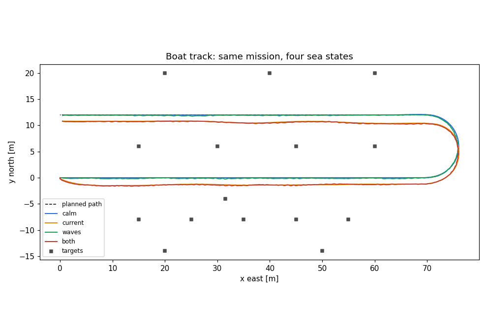
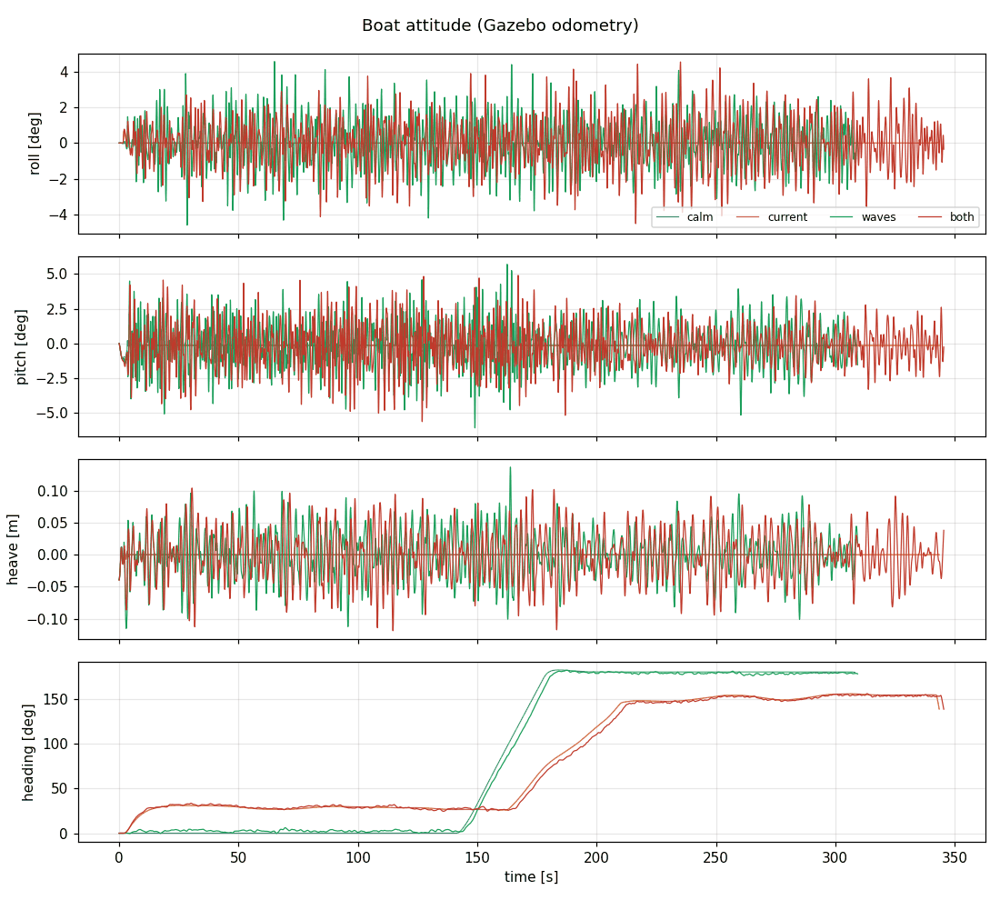
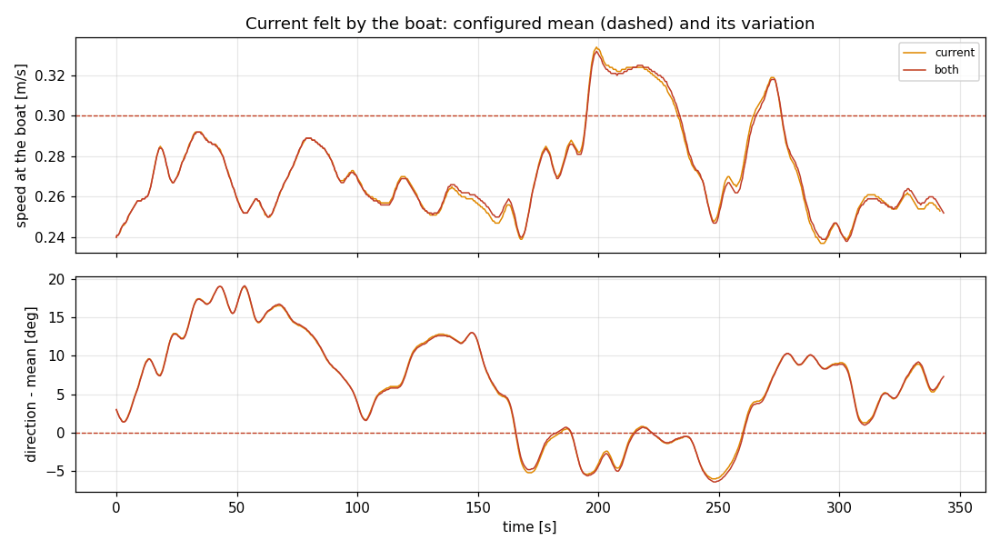
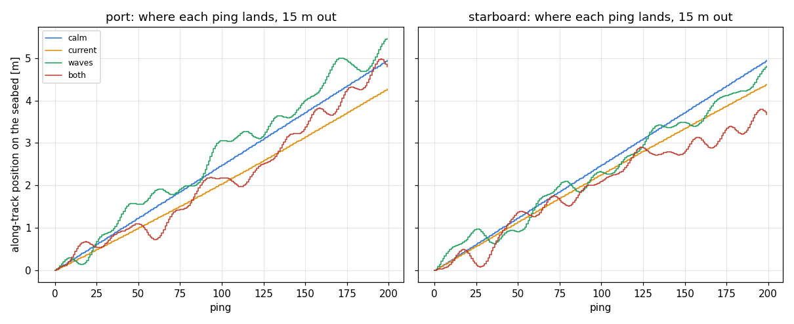
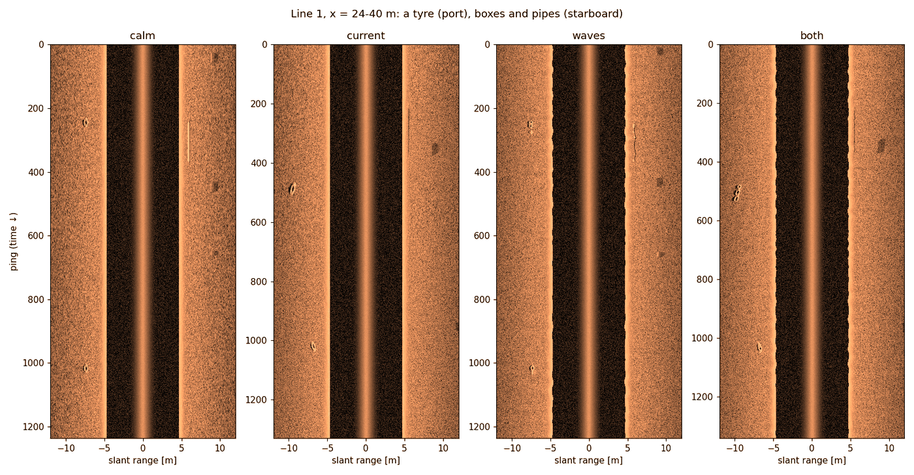
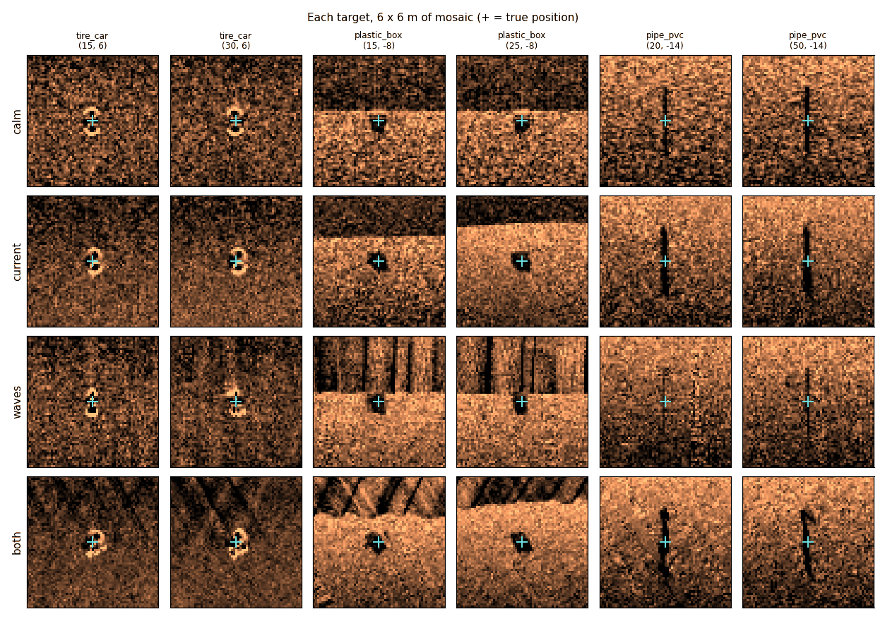

# Waves and current: showing what they do to a side-scan survey

This page shows, with the simulator itself, **the same survey under ideal
conditions and under realistic ones**, and why the second is harder for a
side-scan sonar. It is written so that someone who knows what a USV and an
SSS are, but not this code, can rebuild the test and read the results.

The model behind it is in [`sea_state_model.md`](sea_state_model.md)
(physics, sources, research log §11). The short version: waves push on
the hull in Gazebo, the hull heaves, rolls, pitches and yaws, the sonar
is fixed to the hull, so every ping looks at the seabed from where the
transducer actually is at that instant. Nothing distorts the image
afterwards — every effect below comes out of that chain.

---

## 1. Which real-world problems we can show

"Can simulate" means the effect comes out of the model by itself; the
last column is how this page demonstrates it.

| Phenomenon | Evidence (platform) | Relevant to SSS? | Relevant to a surface vehicle? | Can simulate? | How to demonstrate |
|---|---|---|---|---|---|
| Current pushes the boat off its line; the boat crabs to hold it | Fossen 2011 §8.3; Paravisi et al. 2019 (USV sim) | Yes — the swath is no longer where it was planned | Yes | **Yes** | Scenario *current*: cross-track error and crab angle vs *calm* |
| Speed over ground changes along the line → along-track stretching / compression | Cobra et al. 1992; Sheffer & Guterman 2018 (AUV) | Yes | Yes | **Yes** | Speed CV; footprint spacing CV |
| Pitch moves the beam's footprint along-track, the same way on both sides (common mode) | Cobra et al. 1992; Lei et al. 2026 (real SSS data) | Yes | Yes — a small hull pitches a lot | **Yes** | Footprint staircase; common-mode std |
| Yaw swings the fan: one side advances while the other lags, growing with range (differential mode) | Anstee 1994 (towfish: yaw most damaging); Lei et al. 2026 | Yes | Yes | **Yes** | Differential-mode std vs range |
| Back-scanning — the same seabed imaged again, "repeated-looking" regions | Anstee 1994 ("backscanning"), USGS sonograph notes | Yes | Yes | **Yes** | Back-scan fraction; a target imaged twice in the waterfall |
| Coverage gaps — seabed skipped between pings | Anstee 1994 (coverage) | Yes | Yes | **Yes** (at long range / large yaw rate) | Gap fraction; targets missed on a pass |
| Uneven insonification of a target (some passes many pings, some few) | follows from the two above | Yes | Yes | **Yes** | Pings per target pass, its spread (CV) |
| Roll steers the beam pattern → port/starboard brightness banding | Kim & Ryou 2020 (USV); Blondel 2009 | Yes | Yes — the surface-platform signature | **Yes** | Smoke `[10]` (±1.1 dB tilt at 8°); banding in the waterfall |
| Heave changes the altitude → wavy first-bottom return, slant-range errors | Hughes Clarke 2003 (surface vessel, swath "wobbles") | Yes | Yes | **Yes** | The seabed line in the zoomed waterfall |
| Targets mislocated or distorted in a mosaic built without attitude correction | Cobra et al. 1992; Sheffer & Guterman 2018 | Yes | Yes | **Yes** | Target shift / image similarity vs calm |
| Smear *within* one ping from fast rotation | Preston & Gorton (IOA, multibeam sidescan) | Yes | Yes | **No** (stop-and-hop pings) | — estimated ≤ half a footprint at 10°/s |
| Doppler from platform motion | general | Marginal at 450 kHz CW pings of this length | Yes | **No** | — |
| Breaking waves, wind on the hull, a moving water surface | general | Indirect | Yes | **No** | — (`sea_state_model.md` §8) |

Where no published SSS-on-USV evidence exists for an effect (most of the
geometric ones are documented on towfish and AUVs), this page is the
**controlled experiment** that demonstrates it: one simple world, one
straight survey, the same seed, four sea states.

---

## 2. Step by step

### Step 0 — build

```bash
cd ~/ros2_ws && source env.sh
colcon build --packages-select blueboat_sss_sim
```

### Step 1 — the survey path (MCS Pattern Designer)

1. Open MCS → **Pattern Designer**. *Set GPS Origin* to any coordinates
   (we used 33.930621, 130.731285 — the beach site; the physics does not
   depend on where).
2. Waypoints: **L1_start (0, 0)** → **L1_end (70, 0)** → **L2_start
   (70, 12)** → **L2_end (0, 12)**. Segment L1_end → L2_start: *Circular
   arc*, deflection **180°** (a U-turn); the others *Straight*.
3. Mission speed **0.8 m/s**. Save as **`sea_validation`**.

That is two parallel 70 m lines 12 m apart, sailed east then west. The
boat spawns at (0, 0) facing east, exactly on the first line. (Done
headless the same way: `MissionModel.add_waypoint` + `sample_mission` +
`save_mission` of `mcs/designer` — the files are in
`~/.config/blueboat_mcs/trajectories/sea_validation.yaml`.)

### Step 2 — the world (World Builder)

1. `ros2 run blueboat_sss_sim world_builder` → *Create* → path
   **sea_validation**.
2. **Limits**: rectangle x −20 … 95 m, y −26 … 38 m. No walls.
3. **Depth**: preset **Flat**, depth **5 m** (build a second world at
   **1.5 m**, like the beach corpus).
4. **Objects**: no random classes; place by hand (Screen 5):

   | What | Where (x, y) [m] | Why |
   |---|---|---|
   | 5 × `plastic_box` | (15, −8) (25, −8) (35, −8) (45, −8) (55, −8) | 8 m to starboard of line 1 — a row of identical targets |
   | 4 × `tire_car` | (15, 6) (30, 6) (45, 6) (60, 6) | 6 m to port of **both** lines — seen twice, from opposite directions |
   | 3 × `plastic_box` | (20, 20) (40, 20) (60, 20) | 8 m to starboard of line 2 |
   | 2 × `pipe_pvc`, 3 m, across track | (20, −14) (50, −14) | straight edges across the swath show along-track wobble |
   | 1 × `pipe_pvc`, 3 m, along track | (31.5, −4) | a straight edge along the track shows range wobble |

5. Save as **`flat_5p0m`** (and **`flat_1p5m`**). The worlds land in
   `~/worlds/sea_validation/`.

**These inputs live outside every repository.** By 2026-10-20 they had been lost:
`~/worlds/sea_validation/` was empty since 2026-10-12, and the trajectory was deleted. On
2026-10-20 they were rebuilt headless, exactly to Steps 1–2, through the tools' own code:
- Step 1 through the designer's `MissionModel` / `sample_mission` / `save_mission`. The path
  comes out at 158.85 m, 198.6 s.
- Step 2 through `BuilderState` / `build_world_folder`. The objects come from the Screen-5
  stamp form with its defaults, seeded as `PlacePage` seeds it (`[5, 1]`); the pipes are set
  to 3 m as a Screen-5 edit.

The script is `~/ros2_ws/sim_runs/sea_validation/build_inputs.py`, also outside the
repositories. It refuses to overwrite and is deterministic, so it reproduces these inputs.
Each object's drawn sizes, headings and burials differ from the lost originals, which no
record kept. Positions, classes and the survey are as specified.

### Step 3 — run the four sea states

**Automatically (recommended):**

```bash
cd ~/ros2_ws/src/BlueBoat-SideScanSonar/BlueBoat-SSS-Sim/blueboat_sss_sim
python3 -m test.gazebo_sea_test --world-dir ~/worlds/sea_validation/flat_5p0m \
    --out ~/ros2_ws/sim_runs/sea_validation/$(date +%F)_5m
```

It runs, one after the other and headless, the same mission with the
same seed (7) in:

| Scenario | Current | Waves |
|---|---|---|
| **calm** | none | none |
| **current** | 0.3 m/s from the north (across the lines), *natural* variation | none |
| **waves** | none | *Light chop* (0.15 m) from the north-east, short-crested, no wakes |
| **both** | as *current* | as *waves* |

~5–6 minutes each, launch included (the whole path; 5¼–6 min per
scenario on 2026-10-09; `--quick` sails line 1 only). A start
that never gets going — no progress along line 1 after 45 s — is
relaunched, up to twice, and the attempts are recorded in each
`run.yaml`. Until 2026-10-09 that happened when the simulated controller
missed its one-shot "ready" signal; BlueBoat-Control now re-publishes it
every second, so the relaunch is only a guard. Every run
is recorded (`<out>/<scenario>/bag`) and analysed; the report is
`<out>/report.md`, the figures `<out>/*.png`. Change the sea with
`--current-speed --current-from --variation --waves --waves-from --crest
--wakes`; re-analyse without re-running with `--analyse-only`.

**By hand, from MCS:** launch the mission on the world (*Launch Mission →
simulation → world `flat_5p0m`*), and in the sea-state dialog set the
table's settings for each scenario (seed 7). Record with
`ros2 bag record --use-sim-time -o <dir> /blueboat/odom /current
/sim/sea_state /side_scan_sonar/ground_truth/sensor
/side_scan_sonar/port/profile /side_scan_sonar/starboard/profile`, then
`sss_sea_validation run <dir-with-bag/-and-run.yaml> --out <dir>` /
`sss_sea_validation compare <run-dirs…> --out <dir>` (`--out` is required
by both).

### Step 4 — what to look at

| Figure | What it shows | What to expect |
|---|---|---|
| `compare_tracks.png` | the planned path and the four tracks | *current* and *both* sit off the line, the boat crabbing into the flow |
| `compare_attitude.png` | roll, pitch, heave, heading | flat lines in *calm* / *current*; wave-period motion in *waves* / *both* |
| `compare_footprint.png` | **where each ping lands on the seabed, 15 m out**, ping after ping | *calm*: a straight staircase. *waves*: the beam stalls, steps **back** (seabed imaged again) and surges ahead |
| `compare_waterfall_zoom.png` | the waterfall around a tyre, boxes and pipes | *waves*: wavy seabed line, a target appearing twice, a pipe broken into pieces, boxes stretched |
| `compare_target_chips.png` | each target in a mosaic placed with position + heading only | *waves*: targets shifted and reshaped against *calm* |
| `compare_waterfalls.png`, `compare_mosaics.png` | whole line, whole area | the overview |
| `compare_current.png` | the current the boat felt against the configured mean | wandering smoothly about the dashed mean, never jumping |

### Step 5 — compare with the real boat

```bash
sss_sea_validation svlog ~/ros2_ws/data/SSS_data/beach_sept/bath3.svlog --altitude 1.4 --out <dir>
sss_sea_validation svlog ~/ros2_ws/data/SSS_data/OneLineHarbourClean70m.svlog --altitude 7.3 --out <dir>
```

reads the boat's own attitude (id-150 `ATTITUDE`, 25 Hz) out of a field
recording and reports the same roll / pitch / yaw statistics and the
footprint displacement they imply, to put beside the simulated scenario.

---

## 3. Results (2026-10-09: one hull model, 100 Hz pose)

Two campaigns of `test/gazebo_sea_test.py`, the full path (two 70 m lines
and the U-turn, ~160 m) in each of the four sea states, seed 7; current
0.3 m/s from the north, *natural*; waves *Light chop* (Hs 0.15 m, Tp 2.8 s)
from the north-east, short crests, no wakes. Every scenario floats the
same catamaran hull (`sea_state_model.md` §5), and the wrench and the sonar
run on Gazebo's 100 Hz pose (§5.6). Raw runs, reports and all figures:
`~/ros2_ws/sim_runs/sea_validation/2026-10-09_onehull_{5m,1p5m}/` (outside
the repository; the figures below are copies). The 2026-10-08 campaigns
(box hull on calm water, 20 Hz pose) sit beside them for comparison.

**Checks: 5 m world 25 / 25 pass; 1.5 m world 24 / 24 pass + 1 INFO**
(uneven target coverage from waves alone is *not expected* there — see
"Reading it"). Re-run with `--quick` (line 1 only) after BlueBoat-Control's
readiness fix the same day: 25 / 25, every scenario under way on its first
attempt (`…/2026-10-09_controlfix_5m_quick/`).

**2026-10-20, on the rebuilt inputs (0.285 m mount):**

| World | Checks | Failed |
|---|---|---|
| 5 m | 24 / 25 | *waves* "fresh pose" (0.67 % of pings over 60 ms) |
| 1.5 m | 23 / 24 | *waves* "fresh pose" (0.08 % of pings over 60 ms) |

Every physics and sonar check passed. Re-run alone, *waves* passed (0.00 %, worst 10 ms).
The failures are intermittent pose-delivery stalls to the sonar node, with Gazebo at RTF 1.000
throughout. That is `.claude/TODO.md`'s 2026-10-20 item, not a model change. The runs are in
`~/ros2_ws/sim_runs/sea_validation/2026-10-20_{5m,1p5m,5m_waves_rerun}/`.

### What happened to the boat

| | calm | current | waves (5 m / 1.5 m) | both (5 m / 1.5 m) |
|---|---|---|---|---|
| Cross-track error RMS | 0.01 m | 1.36 m | 0.12 m | 1.41 / 1.43 m |
| Crab angle (mean) | 0° | 28° | 1.9 / 2.1° | 29° |
| Mean pitch trim (same hull everywhere) | −0.15° | −0.15° | −0.15 / −0.16° | −0.17 / −0.16° |
| Roll std | 0.00° | 0.00° | 1.36 / 1.52° | 1.38 / 1.46° |
| Pitch std | 0.005° | 0.004° | 1.58 / 1.64° | 1.55 / 1.67° |
| Heave std (sea's own Hs/4 = 0.0375 m) | 0 | 0 | 0.035 m | 0.038 / 0.039 m |
| Heave peak period (sea's Tp 2.8 s) | — | — | 2.9 / 2.7 s | 2.6 s |
| Mean hull height vs calm (impulse conservation) | — | — | 0.8 mm | 0.8 mm |
| Realised current at the boat (set 0.30 m/s from N) | — | 0.272 ± 0.023 m/s, from N +6° ± 7° | — | the same, ± the eddies along the slightly different track |



*The same mission in four sea states. In current (orange, red) the PID
path follower holds a steady 1.3 m offset downstream while crabbing 28°
into the flow; waves alone (green) barely move the track.*





*The current the boat felt: wandering smoothly around the configured
mean (dashed), within its bound, never jumping. "current" and "both" share
the seed, so they coincide until their tracks — and so the eddies they
cross — differ.*

### What happened to the sonar

| | calm | current | waves (5 m / 1.5 m) | both (5 m / 1.5 m) |
|---|---|---|---|---|
| Pings whose footprint steps **back** over imaged seabed, 15 m out | 0 | 0 | **19 % / 8 %** | **19 % / 8 %** |
| … 5 m out | 0 | 0 | **16 % / 0.5 %** | **15 % / 0.5 %** |
| Footprint spacing CV, 5 m out | 0.05 | 0.12 | 1.03 / 0.30 | 1.01 / 0.33 |
| Pitch-like (common-mode) footprint wobble, 5 m | 0.000 m | 0.000 m | 0.127 / 0.031 m | 0.109 / 0.028 m |
| Yaw-like (differential) footprint wobble, 15 m | 0.04 m | (crab) | 0.57 / 0.62 m | (crab) |
| Pings per target pass: mean, CV (calm 3.1, 0.37 / 2.6, 0.41) | — | 4.9, 0.74 / 4.6, 0.77 | 1.7, **0.59** / 2.1, 0.50 | 5.0, **1.26** / 5.5, 1.17 |
| Target passes with **no** ping at all | 0 | 19 % | 0 / 5 % | **23 % / 20 %** |
| Target shift vs the calm survey (median) | 0 | 1.6 / 1.0 m | **0.0 m** | 1.2 m |
| Target image vs the calm survey: correlation | 1 | 0.42 / 0.38 | 0.47 / 0.56 | 0.38 / 0.31 |

The *waves* row's zero median shift is the one-hull decision at work:
waves now distort a target's image (correlation 0.47) without moving its
mean position, because the calm and wave runs no longer float different
hulls (on 2026-10-08 the switch alone shifted every target 0.2 m).



*Where each ping lands on the seabed, 15 m out, ping after ping (5 m
world). Calm: a regular staircase. Waves: the beam stalls, steps back
over seabed it has already imaged, then races ahead — the same patch is
sampled several times while its neighbour gets one ping.*



*Line 1 between x = 24 and 40 m: a tyre to port, a box row and two pipes
to starboard. Waves: the seabed line (±5 m) turns jagged, the pipe
breaks into dashes, targets repeat or stretch. Current: the track offset
moves every target to another range and the slower, crabbing boat
stretches them along-track.*



*Each target in a mosaic built the way a display without attitude
correction builds it (position + heading only). Waves break the pipes and
streak the near range (heave changes the slant-range correction ping by
ping); waves + current bend a straight pipe into an S and shift the box
row.*

### Against the real boat

The same attitude statistics read from field recordings (id-150
`ATTITUDE`, 25 Hz; `sss_sea_validation svlog`, results in
`~/ros2_ws/sim_runs/sea_validation/corpus/`):

| | roll std | pitch std | pitch trim at rest → under way | roll / pitch rate std | yaw rate std | pitch-like footprint wobble |
|---|---|---|---|---|---|---|
| Real, `OneLineHarbourClean70m` (one line, 7.3 m) | 0.93° | 0.88° | +1.2° → +2.1° | 6.8 / 5.4 °/s | 5.1 °/s | 0.11 m at 7.3 m |
| Real, `reflectionEvidenceFullharbour` (7.3 m) | 1.04° | 1.13° | (clock frozen) / +1.9° | 16 / 16 °/s | 14 °/s | 0.14 m at 7.3 m |
| Real, `bath3` (beach, whole session incl. turns, 1.4 m) | 1.96° | 2.76° | +2.8° → +0.3° | 10 / 15 °/s | 9 °/s | 0.07 m at 1.4 m |
| **Sim, light chop** (5 m / 1.5 m world) | 1.36 / 1.52° | 1.58 / 1.64° | −0.15° (one hull; no static offset modelled) | 5.7–6.1 / 7.0 °/s | **1.2–1.3 °/s** | 0.127 m at 4.7 m / 0.031 m at 1.35 m |

Roll, pitch, their rates and the footprint wobble they imply fall inside
the real boat's band. The real boat's **trim** is a static per-session
offset (present at rest: load or IMU mounting) plus a small dynamic part
of inconsistent sign — not modelled, deliberately (`sea_state_model.md`
§5). The simulated **yaw rate is 4–10× lower** than the field's (part of
the field figure is IMU noise and helm activity, but not all of it), so
the yaw-driven effects above are **conservative** (`TODO.md`).

### The station's empty-world path (stock `ocean` world)

MCS runs a mission without a world folder on BlueBoat-Control's stock
world, with the sea node started beside it, since 2026-10-09 for every
choice, calm water included. Checked live that day:
`world_launch.py gui:=false sliders:=false` (the world `Sim_launch.py`
starts, run headless here — `Sim_launch.py` itself leaves `gui` at its
default `true`)
plus exactly the companion MCS sends for a calm, no-current choice
(`sea_state_launch.py world_name:=ocean`); an idle boat, no controller.

The first pass found a defect. The node judged "this world already has
`ApplyLinkWrench`" by the `/world/ocean/wrench` topic, which its own
bridge advertises, so it never injected the system and every wrench went
to a topic nothing applied — while the readback said the hull was
active. Fixed: the node now looks for `/wrench/persistent`, which only
the system creates (smoke `[10]` pins the rule). The same idle boat,
Light chop from the north-east, seed 7, 60 s of the 100 Hz pose:

| | roll std | pitch std | heave std (Hs/4 = 0.0375 m) |
|---|---|---|---|
| Stock world **before** the fix (wrench never applied: orbital drag only) | 0.31° | 0.18° | 0.058 m |
| Stock world after the fix | **1.29°** | **1.66°** | **0.038 m** |
| Validation world (plugin in its SDF), same sea | 1.22° | 1.72° | 0.0385 m |

On calm water the catamaran hull holds the boat level (readback
`hull: catamaran, active`, one wrench per 10 ms step, roll/pitch/heave
std 0). A live "Change sea state…" command to Light chop then raises the
motion to 1.5° roll, 1.3–1.6° pitch, 0.03–0.04 m heave std within a
minute. The companion stops cleanly when MCS stops it (process-group
SIGINT; 3 of 3).

### Reading it

* **The water is reproducible and realistic in the sense that matters
  for the thesis**: same seed, same sea; a current that wanders around the
  mean you set, smoothly and within bounds; a hull that rides the waves
  (heave std = Hs/4 at the wave period, impulse conserved) — the same
  hull in every scenario, so calm-vs-waves isolates the sea.
* **The sonar is no longer a bench instrument once waves are on.** At
  5 m of water one ping in five or six images seabed it has already
  imaged, and target images keep about half their similarity to the calm
  survey. With the current as well, 23 % of target passes are missed and
  the images keep a third of their similarity.
* **Depth matters, and the model says why.** Pitch moves the footprint by
  altitude × tan(pitch): in 1.5 m of water that is 3 cm, so near-range
  coverage stays even (the INFO row: back-scan at the targets' range
  < 5 %); yaw moves it by range × sin(yaw), whatever the depth, so the far
  swath still back-scans 8 % of the time. This is the shallow-vs-deeper
  difference the beach and harbour corpora show, now separated mechanism
  by mechanism.
* **Current is the dominant degradation of a straight survey** with this
  controller: a steady 1.3 m offset and a 28° crab, which rotates the
  swath against the planned line and changes every target's range.

## 4. Limits of this demonstration

* **The comparison is model-conditional** (CM-13): it shows that the
  simulated chain produces the qualitative effects real deployments
  suffer, at magnitudes inside the band the real boat's attitude implies
  — not that the simulator is exact.
* The boat's hydrodynamic coefficients are the BlueROV2's (S6), the hull
  damping is a judgement value (S10), and the controller is
  BlueBoat-Control's PID following a time-parameterised path.
* **One hull model, no dynamic trim:** since 2026-10-09 the catamaran
  hydrostatics carry the hull in every scenario (calm included), so the
  four runs differ only by the sea — and in every MCS simulation, the
  stock empty world included. Dynamic trim/squat is not modelled
  (the corpus shows it small and of inconsistent sign), nor the real
  boat's static per-session pitch offset (+1.2…+2.8° at rest — load or IMU
  mounting), which would only shift every footprint by a constant.
* No intra-ping motion, no Doppler, no wind (§1).
* One seed per scenario; the current's mean over a 5-minute run is
  checked against the run's own statistics, not to the decimal.
